<p align="center">
  
</p>

# Cueflow

**Turn UI walkthroughs into maintainable, multilingual guides.**

[MIT license](LICENSE) · [Contributing](CONTRIBUTING.md) · [Built by Byte42](https://byte42.it/)

<p align="center">
  
</p>

Narrated, animated walkthroughs of a web interface — without recording a video.

You give Cueflow a **kit**: the static HTML of your site's screens (the real CSS, fonts and layout, no backend).
Through an **MCP server** an AI assistant composes guides on top of it: a camera that frames only the part of the
screen that matters, a cursor that moves and clicks, text that gets typed, progress bars that fill, and a narration
in as many languages as you like. The result is **one self-contained HTML file** that plays like a small video but
is really the live page, shrunk to a window.

Changing a text, translating a guide or following a UI change means editing a line and rebuilding, not re-shooting
and re-dubbing.

## Why Cueflow?

Product onboarding, support tutorials and internal training often become outdated as soon as the interface changes. Cueflow describes a walkthrough as structured data: screens, actions, camera framing and narration. Developers can version and review those guides alongside their application, while AI assistants help author them through the Model Context Protocol (MCP).

- **Use your real interface:** static scenes reuse your CSS, fonts and layout.
- **Guide attention:** camera framing, cursor movements, clicks, typing and highlights show each action.
- **Translate narration:** language-specific text and audio share the same timeline.
- **Share one HTML file:** scenes, player and generated audio are packaged together.
- **Review AI output:** validate selectors and inspect preview frames before sharing a guide.

Cueflow is an early open-source prototype. Feedback, example kits, bug reports and contributions are welcome through this repository's issues and pull requests.

## Getting started

Cueflow is a tool you install once and point at any number of projects. It does not live inside your product.

1. **Install it** (Node.js 22 or later): `npm install -g @byte-42/cueflow` — or nothing at all, and use `npx @byte-42/cueflow …`. The command is `cueflow`: on its own, inside your project's folder, it opens Studio in your browser (and creates `.cueflow/` there the first time); `cueflow ../my-project` or `cueflow /full/path/to/project` opens it on another folder.
   Playwright (for capture, previews and posters) is optional: `npx playwright install chromium`.
2. **In your project's folder, run `cueflow init`.** It creates `.cueflow/`, the kit of the project, and fixes once where
   the result goes: `cueflow-dist/` next to it (change it with `--out-dir`; it is stored in `.cueflow/cueflow.json`
   and stays the same). `.cueflow/` is meant to be committed with your product; its own `.gitignore` leaves out `.env`
   and the voice cache. Every `cueflow` command run anywhere inside the project finds `.cueflow/` by itself.
3. **Connect your AI assistant to it.** Three ways; pick what your assistant can do:
   - **Through Studio** (nothing to install, works in the terminal, in VS Code, anywhere an assistant can run `curl`): run
     `cueflow studio`, press the **AI** button (or copy what it prints in the terminal) and paste the prompt into your
     assistant. See *Talking to your assistant* below.
   - **As an MCP server**, if your assistant has the `claude` command: `claude mcp add cueflow -- cueflow mcp`.
   - **As an MCP server without the `claude` command** (for example the VS Code extension): create `.mcp.json` at the
     project root with `{"mcpServers":{"cueflow":{"command":"cueflow","args":["mcp"]}}}`.
4. **Ask for tutorials.** Say you want tutorials. Cueflow gives the assistant the method (`get_method`) and the state of the
   kit (`get_brief`): it starts by asking which site (a folder or a live address), then talks the brief through with you
   (audience, tone, languages, rules, how names are pronounced). It captures the screens, writes the steps (each one
   checked against the real elements), looks at frames with `preview_frame`, and builds the guides and the docs site.
   You review the previews and the narration.
5. **Publish** `cueflow-dist/` (one HTML per guide, plus `site/` for the catalog). No server is needed to view it.

Nothing product-specific (names, colors, texts, rules) belongs in Cueflow itself. Until the package is on npm, clone
this repository, `npm install && npm run build`, and run `node <clone>/build/cli.js …` (or `npm link`).

### Cueflow Studio

`cueflow studio` opens an editor in your browser (it listens on this computer only), dark by default (◐ switches to
light). On a first start, with no tutorial yet, Studio shows a **prompt to paste into your assistant**; the first tutorial brings the normal view by itself. On the left, **all your tutorials as thumbnails**, like the slides of a presentation, with “+” to add one and a trash icon on each (a deleted tutorial moves to `trash/` in the kit, nothing is erased; it also leaves the dashboard). A bar
of **pages for the selected tutorial** sits at the bottom, as in a video editor:

- **Media**: *edit what the viewers read*: click an element of a screen (a button, a description) and change its text or
  its placeholder, title, alt: it is saved in the version of the language chosen at the top (each language is its own
  sub-project: `scenes/<lang>/<screen>.html`, created from the base screen the first time, so editing English never
  touches Italian). A file can be replaced with another, and stylesheets and scripts edited as text. Every such edit is
  written to `changes.json` as a note for the assistant: *"the button #choose-file was changed from … to …"*. It is
  information, not a command to replay: the assistant reads it (`get_changes`), works out why the person did it and takes
  it into account (a narration that still names the old button, a description), then marks it seen. The files of *this* tutorial (screens used only by it, pictures and logos in `media/<tutorial>/`) apart from
  **Shared media** (what several tutorials use: `shared/` styles, fonts, icons, and screens used by more than one). Each
  file says who uses it; drop files to upload; a file that a screen uses cannot be deleted. Click an element of a screen to
  copy its selector.
- **Timeline**: the video, and at the bottom the timeline drawn to scale (steps, narration, action markers; zoom with
  − / +). **Drag a step to change the order**; `+ Step` and `Delete` act on the selected one. On the right, *Narration*
  (text and title of a step, checked when saved), *Actions* (time and duration of each; add one by picking an element in
  the screen) and *Assistant* (write what you want changed and copy the request to your own assistant: Studio does not
  embed one, your assistant edits the same files through Cueflow's tools and Studio shows its changes as they happen).
- **Voice**: who reads this tutorial, in plain words, for everything, a language or one video; try a voice before saving
  it; an Fantastico key is typed here once and kept in the kit's `.env`, never shown again.
- **Preview**: the tutorial as viewers get it, large; with the working copy (browser voice) or built with the final voices.
- **Export**: check this tutorial (also its layout, in a browser) and build it; built files open from here.

**Written guides** have their own tools, not the video ones. Under the videos, the strip lists the written guides of the
dashboard (an item `guide`, or the written part of an item `video`), with `+` to start one, and **Coming soon**: what is
announced, to *Write* (it becomes a written guide with a first section), *Edit* or take off. A written guide has three
pages:

- **Write**: the sections on the left (drag to reorder, `+ Section`, `+ Opening` for a text before the first one, ×
  to delete) and the selected section on paper, with the site's stylesheet and the kit's theme, so it looks as it will
  be read. Text tools only: paragraph, subheading (an `h3`, listed in the side index of the site), quote, bold, italic,
  lists, link, image (saved in `pages/img/`), and `</>` for the HTML of the section (for blocks the toolbar does not
  make). Sections numbered with a `.num` in their title are renumbered when moved; every subheading gets an id. Each
  language is its own file (`pages/<lang>/`): a missing one starts as a copy of the site's language, to translate in
  place. Saving writes the whole file (refused if it changed on disk meanwhile) and leaves a note for the assistant.
- **Details**: how the dashboard presents it, per language: title, kicker, description, what it contains, row, status
  (written guide or coming soon), order in its row; and taking it off the dashboard (its texts go to `trash/`).
- **Preview**: the whole guide, read-only, as it will be read; and the page as last built.

Top right: **AI** (a graduation-cap button: a prompt to paste into your assistant, rewritten with the current state, to carry on in a new session without starting over), **Dashboard** (the title, category and description of each tutorial in the home and its page, per language), **Project** (audience, tone, languages, rules, pronunciation: `brief.json`) and **Build**, which
builds every tutorial and the **dashboard** that gathers them (`site.json` is created, or completed with the new
tutorials, never rewritten). An external voice is called only then, and the page says so before.

If you edit something that an assistant changed meanwhile, the save is refused with a message instead of overwriting.
First version: the timeline does not yet drag actions; scenes are not captured from the page.

### Talking to your assistant

Studio is not an assistant, and it does not need your assistant to be an MCP client. While `cueflow studio` runs it opens
a small door on this computer only (`/agent/`, with a key that is new at each start and stops working when Studio stops):
the **same tools as the MCP server**, over HTTP, usable with `curl`. The AI button gives the prompt that tells the
assistant how: read `/agent/help`, call tools with `POST /agent/call/<tool>`, and **listen** with a long request
(`GET /agent/next`) run in the background. The talk goes both ways: when you ask for something in Studio (a new tutorial,
the Assistant tab) it is sent to the assistant that is listening, which does it, reports progress (`/agent/say`) and
finishes (`/agent/done`), and Studio shows it. The AI button has a dot: green when an assistant is connected.

With no assistant connected, the same requests turn into a **prompt to copy and paste** into your assistant instead.

**New** (the `+` at the top of the list) asks what you want to make: a video tutorial, a written guide, or an announcement
of one that is coming. With “Create it with my local assistant” ticked (the default; your choice is remembered) nothing is
created: the request goes to your assistant, which asks you what you want to make and does it. Untick it to create the
empty item yourself. The list shows everything in the order of the dashboard: **drag a thumbnail to change the order**
(dropped in another row it joins that row); the dashboard follows at the next Build.

### Voices

By default a tutorial is read by **the viewer's browser**: free, no key, nothing to set up (it sounds different on every
computer). An external voice is always an explicit choice, never a side effect of having a key:

| Choice | What it is |
|---|---|
| `browser` (default) | the browser reads the text; nothing stored |
| `fantastico` | natural, the same everywhere, generated once and stored; uses your Fantastico credit; needs `FANTASTICO_API_KEY` in `.cueflow/.env` |
| `say` | macOS voices, free and offline |
| `command` | any local program (e.g. Piper), nothing leaves the computer |
| `none` | silent, captions only |

`cueflow voices` lists them in words and shows which voice each video speaks with. A voice can be chosen at three
levels, and **what is not set is inherited from the level above**: one video (or one of its languages) › a language
(every video in it) › global › the browser's. In `cueflow.json`:

```json
{
  "outDir": "../cueflow-dist",
  "voices": {
    "default": { "provider": "browser" },
    "languages": { "it": { "provider": "fantastico", "model": "mistralai/voxtral-mini-tts-2603", "voice": "en_paul_neutral", "style": "calm, professional" } },
    "guides": { "upload": { "default": { "provider": "say" } } }
  }
}
```

In Studio, open **Settings → General audio settings**, choose **Professional voices · Fantastico**, and connect your key.
Get a key or recharge your credit at [cueflow.fantastico.cc](https://cueflow.fantastico.cc). Models and voices are loaded
from the Fantastico catalogue; **Preview** uses the selected model, voice and style before saving the voice choice.
Both previews and new narration use Fantastico credit; cached audio can be played again without another generation.
When credit runs out, Studio shows the same recharge link. For account keys (`ck-fant-…`), Studio shows the available credit in USD, a low-credit notice and a refresh button. Project keys cover multiple accounts, so Studio links to the portal instead of showing a guessed balance. The key stays in the kit's ignored `.env` file and is never
returned to the browser. No direct paid-provider key is used.

The assistant uses `get_voices` (including the live speech catalogue when a key is configured) and `set_voice`. `CUEFLOW_TTS` still works for scripts, but only where `cueflow.json` chooses nothing.

## The kit

```
my-kit/
  capture.json optional: how to capture the scenes from the live site (see below)
  shared/     CSS, fonts, icons, libraries copied from the real site
  scenes/     one static HTML page per screen/state, using shared/
  guides/     one JSON per guide: camera, actions, narration per language
  theme/      optional: theme.css and labels.json, the look and words of the player
  site.json   optional: the catalog of a docs site (see below)
  pages/      optional: the written guide of each site item, as HTML fragments
  audio/      text-to-speech cache (hash of text + voice + language)
  dist/       output: one HTML file per guide
```

Scenes reference `shared/` instead of copying styles, so when the site's CSS changes every guide follows at the next build.
Give elements an `id` or a `data-cue="…"` attribute: that is what guides point at.

A built guide carries each stylesheet and image of `shared/` once, whatever the number of scenes that use it, and of
each `@font-face` only the best format on disk (woff2, else woff, else ttf/otf): eot, svg and the other fallbacks
for old browsers are left out.

### Capturing the scenes

`node src/cli.ts capture --kit <kit>` opens the live site in Chromium, brings each page to the state a scene needs and
saves it as a static scene, copying its stylesheets, fonts and images to `shared/` with the path they have on the
server. What to capture is data, `capture.json`:

```json
{
  "base": "http://localhost:8080", "lang": "en", "viewport": { "width": 1280, "height": 720 },
  "login": { "url": "/login", "steps": [{ "fill": "#user", "value": "${APP_USER}" }, { "fill": "#password", "value": "${APP_PASSWORD}" }, { "click": "button[type=submit]" }] },
  "remove": ["#chat-widget", ".cookie-banner"],
  "replace": [{ "text": "Real Customer Ltd", "with": "Acme Ltd" }],
  "scenes": [
    { "name": "orders", "url": "/orders", "cues": { "new-order": "button:has-text('New order')" } },
    { "name": "new-order", "steps": [{ "click": "button:has-text('New order')" }, { "waitFor": ".modal" }],
      "cues": { "dialog": ".modal-content" }, "hide": [".modal .preview"], "script": "capture/new-order.js" }
  ]
}
```

Steps are `goto`, `click`, `fill`, `type`, `press`, `select`, `wait` and `waitFor`; selectors are Playwright's (CSS,
`text=…`, `:has-text(…)`). `cues` gives elements the `data-cue` a guide points at, `remove` drops elements (globally or
per scene), `hide` keeps them hidden for a guide to `show`, `replace` swaps texts (real names, plates, emails: scenes
must hold synthetic data only), and `script` runs a file of the kit in the page for what selectors cannot say.
`${NAME}` is read from the environment, so passwords stay out of the kit. A scene without `url` goes on from the
page the previous one left. The capture never changes the live page it reads (scripts aside): the scene is a copy,
without scripts, handlers or forms, with field values frozen. Native date and time fields become text written in
`lang`, because a native field shows the format of whoever watches (`"nativeInputs": true` keeps them).
`--scene <name>` writes only that scene.

### Theme

The player's colors, fonts and shapes are CSS variables (`--cf-bg`, `--cf-fg`, `--cf-accent`, `--cf-font`,
`--cf-stage-radius`… see the top of `src/player/player.css`). `theme/theme.css` is added after the player's own
stylesheet, so it can override them or restyle anything else; fonts and images it points at are inlined.
`theme/labels.json` changes the player's interface words, or adds a language (built in: en, it, fr, de):

```json
{ "en": { "steps": "Chapters", "step": "Chapter" } }
```

An example theme is in `examples/themes/paper/`: copy it to `<kit>/theme/`.

The Cueflow mark sits in a corner of the picture; `player.brand` moves it to the control bar (`"controls"`, never over
the scene) or removes it (`"off"`).

### Player options

Each guide can tune the player in a `player` block (all optional):
`captions` (`below`, `overlay`, `off`), `chapters`, `speeds` (e.g. `[1, 1.5]`), `transcript`, `brand` (`stage`,
`controls`, `off`), and
`fallbackVoice: "browser"` to read silent builds with the browser's voice. `pronunciation` maps written words to
how the voice must say them (audio only; the brief's pronunciation applies to every guide). A link ending in `#step-3` opens the guide at that step; the word for step in the guide's languages works too (`#passo-3`).
Before the video starts, and when it ends, the play button sits on a veil with its words under it (what it does, the item's
`duration`, or the step a link starts from); a theme changes the veil with `--cf-veil-bg`, `--cf-veil-blur`, `--cf-veil-fg`
and `--cf-veil-muted`.

## Use

```bash
# Requires Node.js 22.18 or later; run from the repository checkout.
npm install
node src/cli.ts build upload --kit examples/demo-kit     # → examples/demo-kit/dist/upload.html
node src/cli.ts validate upload --kit examples/demo-kit
```

Open the generated HTML in a browser. Without a voice the guide is silent (captions only, timings estimated).
`CUEFLOW_TTS` chooses the voice; the narration is synthesised once per text and cached in `audio/`:

| `CUEFLOW_TTS` | Voice |
|---|---|
| `fantastico` | Fantastico speech (`CUEFLOW_TTS_MODEL`, `CUEFLOW_TTS_VOICE`), stored as playable WAV; needs `FANTASTICO_API_KEY`, which alone does not switch it on |
| `say` | the voices of macOS, offline and free: the first one installed for the guide's language, or `CUEFLOW_TTS_VOICE`; AAC in m4a |
| `command` | any local program: `CUEFLOW_TTS_COMMAND` with `{text}` (a file with the text), `{out}`, `{lang}`, `{voice}`, and `CUEFLOW_TTS_FORMAT` (mp3, m4a, wav, ogg; default wav). Piper: `piper --model it_IT-paola-medium.onnx --output_file {out} < {text}` |
| `none` | silent |

These variables are for scripts; a project normally chooses its voice in `cueflow.json` (see Voices above). With audio, each step lasts as long as its recording and the actions placed in percentages follow it.

### Checking a guide

```bash
node src/cli.ts validate upload --kit examples/demo-kit            # selectors, ids, narrations
node src/cli.ts validate upload --layout --kit examples/demo-kit   # also plays it: every element used must be visible and inside the scene
node src/cli.ts preview upload --step 2 --at 80% --kit examples/demo-kit
node src/cli.ts preview upload --all --kit examples/demo-kit       # one PNG per step + a contact sheet, in dist/preview/
```

`--layout` catches what the HTML alone cannot tell: an element below the scene's height (raise the guide's
`viewport`), or one hidden at the moment the cursor goes to it. `preview --stage` renders the picture alone, without
cursor, highlight and mark, as for a poster. Previews run the browser in the guide's language (`--lang` to choose).

### A docs site

`node src/cli.ts site --kit <kit>` turns the kit's `site.json` into a small static docs site in `dist/site/`:
a home page (a featured tutorial, quick access, rows that scroll sideways, a hover preview with the steps and the
contents) and one page per item with its video, the transcript and the written guide. A left bar opens the list of
tutorials, the index of the page (searchable, with print to PDF of chosen sections) and, when `requestEndpoint` is
set, a dialog that POSTs `{ topic, message?, name?, email?, page }` to it. `--posters` renders a frame of each
guide as its cover (needs Playwright). An item without `duration` gets one computed from its guide ("about 3 min").

```json
{
  "title": "Acme Portal Help", "lang": "en", "featured": "upload",
  "rows": [{ "id": "ready", "title": "Watch and read" }, { "id": "soon", "title": "Coming soon", "band": true }],
  "items": [
    { "id": "upload", "row": "ready", "status": "video", "guide": "upload", "title": "How to upload a document" },
    { "id": "search", "row": "soon", "status": "soon", "title": "Finding a document" }
  ]
}
```

`favicon` and `stylesheets` (remote stylesheets such as web fonts, linked from every page) are optional; `brand.logo`
and item icons are SVG (inlined, they take the text color) or png, jpg, gif, webp. `colorScheme` picks the site's
built-in colors: `light` (default), `dark`, or `auto` to follow the visitor's system; a theme's own `:root` colors
always win over them, so a theme that is only light needs nothing, and one that also wants a dark look sets it under
`@media (prefers-color-scheme: dark)`. Text on the primary color is `--cf-site-on-primary`, labels and panels laid
over pictures use `--cf-site-veil`.
`pages/<id>.html` holds `<section id="…" data-title="…">` blocks with `h2`/`h3[id]`: the sections become the index
and the printable units. The site is styled with `--cf-site-*` variables (top of `src/site/site.css`), set in the
same `theme/theme.css` as the player; its interface is in English or Italian (`lang`), and `site.json` `labels`
overrides any word. See `examples/demo-kit`.

### Tutorial requests

With `requestEndpoint` set, the site offers a "request a tutorial" dialog. It sends
`POST <requestEndpoint>` with `Content-Type: application/json` and
`{ "topic": "...", "message"?: "...", "name"?: "...", "email"?: "...", "company"?: "...", "page": "/path" }`
(`company` is a honeypot: a person never fills it, a bot does). A `2xx` answer means sent; `422` tells the visitor
to check the fields, `429` to retry later. Where the requests go is up to the endpoint: the page never knows.

The endpoint usually lives on the product's own domain, and the docs on another one: then the browser first asks the
endpoint whether it accepts the docs' origin (a CORS preflight), and refuses to send if it does not. Set `url` in
`site.json` to where the site is published, and run `node src/cli.ts check-endpoint --kit <kit>` before publishing:
it sends that same preflight and tells you which origin to allow.

### Languages

A guide lists its `languages`; every text in it can be one string or one per language: narration, step titles,
and the text that `type`, `set`, `value` and `select` actions write. When a screen itself must change language, put its translation in
`scenes/<lang>/<scene>.html`, with the same ids: the player shows it for that language, and validation checks the
selectors in every version.

A docs site offers `languages` (with a `fallback`, used when the browser asks for none of them) and chooses one for
all its pages and players: the visitor's earlier choice, else the browser's language, else the fallback. Catalog texts
can be given per language, and a written guide is translated in `pages/<lang>/<id>.html`; until it is, the page shows
the original with a note.

### With an AI assistant (MCP)

```json
{
  "mcpServers": {
    "cueflow": {
      "command": "node",
      "args": ["/path/to/cueflow/src/cli.ts", "mcp", "--kit", "/path/to/my-kit"]
    }
  }
}
```

| Tool | What it does |
|---|---|
| `get_voices`, `set_voice` | the voices in plain words and who speaks with which; choose one for everything, a language, or one video (inherited downwards) |
| `get_method` | the working method, the same for every product: read first. Also summarised in the server's `instructions` |
| `get_brief`, `set_brief`, `set_source`, `init_kit` | where the kit stands and what to do next; the agreed brief (`brief.json`: site, source, audience, tone, languages, rules, pronunciation, maximum length); which site the tutorials are for (a folder or a live address); the kit's folders |
| `capture_scenes` | capture the scenes from the live site described in `capture.json` |
| `list_scenes`, `inspect_scene` | what screens exist, and which elements (selector, text, hidden?) can be targeted |
| `create_guide`, `add_step`, `replace_step`, `remove_step`, `get_guide` | compose the timeline |
| `set_narration` | write or translate the narration of a step, per language |
| `validate_guide` | selectors must exist in the scene current at each step, ids unique, every language narrated; `layout` also checks visibility and position in a browser |
| `preview_frame` | render any instant of the guide as an image (`at_ms`, or `at` as a percentage of the narration), to check the framing |
| `validate_site`, `build_site` | check and build the docs site from `site.json` |
| `build_guide` | write `dist/<guide>.html` |

`add_step` checks the selectors immediately, the way a chess lesson checks a move: a step that points at an element
that does not exist is refused with a readable message, so the assistant corrects itself.

## A step

```json
{
  "id": "send",
  "camera": { "target": "#upload-card", "padding": 24 },
  "actions": [
    { "do": "move", "to": "#upload-btn", "at": 0 },
    { "do": "click", "to": "#upload-btn", "at": "25%" },
    { "do": "show", "to": "#progress", "at": "30%" },
    { "do": "tween", "to": "#progress-bar", "prop": "width", "from": "0%", "end": "100%", "at": "30%", "duration": 2200 },
    { "do": "camera", "target": "#upload-card", "at": "86%" }
  ],
  "narration": { "en": "Press Upload…", "it": "Premi Upload…" }
}
```

`at` is milliseconds from the start of the step, or a percentage of the narration length (`"40%"`), so actions stay
in sync with the voice whatever the language or the voice speed. Actions: `move`, `click`, `type`, `highlight`,
`set`, `show`, `hide`, `tween`, `scroll`, `camera`, and for forms `select` (an option, by its text or value), `value`
(set or empty a field at once) and `check` (`"checked": false` unticks). A `click` also dispatches a real click event
inside the scene, so a scene can carry small scripts of its own; the form actions fire `input` and `change`.

## Previews

`capture`, `preview`, `validate --layout`, `site --posters` and `preview_frame` need Chromium:
`npm install playwright && npx playwright install chromium`. To use a Chromium or Chrome already on the machine, set
`CUEFLOW_CHROMIUM` to its executable.

## Development

```bash
npm run typecheck
npm test
CUEFLOW_TTS=none npm run build:demo
```

Use synthetic data in scene kits. Narration is sent to the configured TTS provider when audio generation is enabled. Keep credentials and private customer data out of shared kits and contributions.

Read [CONTRIBUTING.md](CONTRIBUTING.md) before opening a pull request. Every PR must disclose whether an AI agent was used, including the agent, model when known, scope of assistance and human verification. Contributions without AI assistance are equally welcome.

## Undo and redo in Studio

Use **Undo / Redo** in the top bar, or **Ctrl/Cmd+Z** and **Ctrl/Cmd+Shift+Z** outside text fields. Studio keeps the last 50 saved tutorial edits (including camera framing, steps, narration and actions) and scene text/attribute edits per tutorial, across reloads and restarts. An undo restores a newly translated scene to its previous fallback when appropriate. External file changes are preserved: undo stops if the file no longer matches the saved edit. A new edit clears redo. Text fields keep their usual native undo.

**Edit** lets you click an element in a scene, change its text/attributes, or delete it in the selected language. These edits support Undo/Redo. Elements used as camera or action targets must be unlinked before deletion. Switching back to **Video** clears the selection. The action editor still offers element picking when choosing an action target. Existing edits made before this history feature cannot be undone automatically.

## Tutorial orientation

Set `"vertical": true` in a tutorial JSON for portrait playback and mobile MP4 exports (9:16). Omitted or `false` preserves the existing layout. New tutorials always save this boolean, defaulting to `false`. Choose the orientation when creating a video in Studio or with `create_guide`; it cannot be changed afterwards. Vertical tutorials start with a portrait viewport and stage, and scenes and camera framing should be designed for mobile from the start. To use another orientation, create a separate tutorial.

## MP4 export

Export a single tutorial from Studio → Export → **Export MP4**. Choose Large (1920×1080), Medium (1280×720, default), or Small (854×480). It renders the selected language, with recorded narration (generated or uploaded). Steps using browser speech export silently. FFmpeg is included with Cueflow. Install Playwright Chromium (`npx playwright install chromium`); `CUEFLOW_FFMPEG` can point to a custom FFmpeg executable. Windows installations made with WinGet, Scoop or Chocolatey are also detected when missing from PATH. Each size has its own output file. Rendering can take several minutes.

## Status

Proof of concept, used on a first real kit (a back office: 5 scenes captured with `capture`, a 17-step guide, a docs
site). Not done yet: word-level sync with the narration, a TypeScript build step for publishing to
npm.

Audio has been verified end to end with the macOS voices (`CUEFLOW_TTS=say`): real durations, playback, seeking.
The Fantastico path has not run against the real API yet.

## Producer and references

Cueflow is produced and maintained by **Byte42 s.r.l.**, an Italian technology company working on software, artificial intelligence and next-generation payment systems.

- Website and business enquiries: [byte42.it](https://byte42.it/).
- Company information: [Corporate Disclosure](https://byte42.it/corporate-disclosure/).
- Registered address: Via Anna Magnani 38/54, 58100 Grosseto (GR), Italy.
- VAT number: **01762750535** · REA: **GR-232344**.
- Project support and proposals: use this repository's issues and pull requests.

The [full logo](assets/brand/cueflow-logo.png) is intended for light backgrounds. The [square symbol](assets/brand/cueflow-icon.png) is available for GitLab/GitHub project avatars. See [brand notes](assets/brand/design-notes.md).

## License

Cueflow is released under the [MIT License](LICENSE), permitting use, modification and redistribution, including commercial use, subject to retaining the copyright and license notice. Contributions are accepted under the same license; third-party dependencies and assets retain their respective licenses.

Copyright © 2026 Byte42 s.r.l. and Cueflow contributors.
