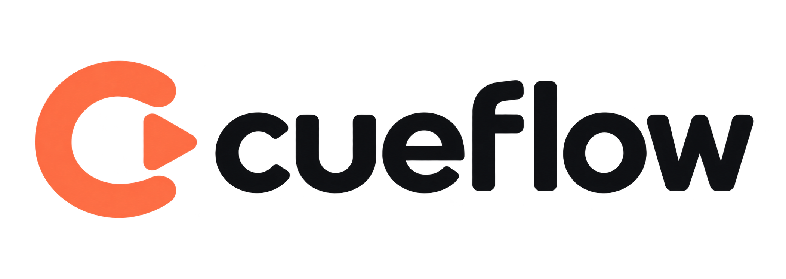

<p align="center">
  
</p>

# Cueflow

**Turn UI walkthroughs into maintainable, multilingual guides.**

[MIT license](LICENSE) · [Contributing](CONTRIBUTING.md) · [Built by Byte42](https://byte42.it/)

Narrated, animated walkthroughs of a web interface — without recording a video.

You give Cueflow a **kit**: the static HTML of your site's screens (the real CSS, fonts and layout, no backend).
Through an **MCP server** an AI assistant composes guides on top of it: a camera that frames only the part of the
screen that matters, a cursor that moves and clicks, text that gets typed, progress bars that fill, and a narration
in as many languages as you like. The result is **one self-contained HTML file** that plays like a small video but
is really the live page, shrunk to a window.

Changing a text, translating a guide or following a UI change means editing a line and rebuilding, not re-shooting
and re-dubbing.

## Why Cueflow?

Product onboarding, support tutorials and internal training often become outdated as soon as the interface changes. Cueflow describes a walkthrough as structured data: screens, actions, camera framing and narration. Developers can version and review those guides alongside their application, while AI assistants help author them through the Model Context Protocol (MCP).

- **Use your real interface:** static scenes reuse your CSS, fonts and layout.
- **Guide attention:** camera framing, cursor movements, clicks, typing and highlights show each action.
- **Translate narration:** language-specific text and audio share the same timeline.
- **Share one HTML file:** scenes, player and generated audio are packaged together.
- **Review AI output:** validate selectors and inspect preview frames before sharing a guide.

Cueflow is an early open-source prototype. Feedback, example kits, bug reports and contributions are welcome through this repository's issues and pull requests.

## The kit

```
my-kit/
  shared/     CSS, fonts, icons, libraries copied from the real site
  scenes/     one static HTML page per screen/state, using shared/
  guides/     one JSON per guide: camera, actions, narration per language
  theme/      optional: theme.css and labels.json, the look and words of the player
  site.json   optional: the catalog of a docs site (see below)
  pages/      optional: the written guide of each site item, as HTML fragments
  audio/      text-to-speech cache (hash of text + voice + language)
  dist/       output: one HTML file per guide
```

Scenes reference `shared/` instead of copying styles, so when the site's CSS changes every guide follows at the next build.
Give elements an `id` or a `data-cue="…"` attribute: that is what guides point at.

### Theme

The player's colors, fonts and shapes are CSS variables (`--cf-bg`, `--cf-fg`, `--cf-accent`, `--cf-font`,
`--cf-stage-radius`… see the top of `src/player/player.css`). `theme/theme.css` is added after the player's own
stylesheet, so it can override them or restyle anything else; fonts and images it points at are inlined.
`theme/labels.json` changes the player's interface words, or adds a language (built in: en, it, fr, de):

```json
{ "en": { "steps": "Chapters", "step": "Chapter" } }
```

An example theme is in `examples/themes/paper/`: copy it to `<kit>/theme/`.

### Player options

Each guide can tune the player in a `player` block (all optional):
`captions` (`below`, `overlay`, `off`), `chapters`, `speeds` (e.g. `[1, 1.5]`), `transcript`, and
`fallbackVoice: "browser"` to read silent builds with the browser's voice. `pronunciation` maps written words to
how the voice must say them (audio only). A link ending in `#step-3` opens the guide at that step.

## Use

```bash
# Requires Node.js 22.18 or later; run from the repository checkout.
npm install
node src/cli.ts build upload --kit examples/demo-kit     # → examples/demo-kit/dist/upload.html
node src/cli.ts validate upload --kit examples/demo-kit
```

Open the generated HTML in a browser. Without a TTS key the guide is silent (captions only, timings estimated).
To explicitly build without audio, set `CUEFLOW_TTS=none`.
With `OPENAI_API_KEY` set, the narration is synthesised once per text and cached in `audio/`.

### A docs site

`node src/cli.ts site --kit <kit>` turns the kit's `site.json` into a small static docs site in `dist/site/`:
a home page (a featured tutorial, quick access, rows that scroll sideways, a hover preview with the steps and the
contents) and one page per item with its video, the transcript and the written guide. A left bar opens the list of
tutorials, the index of the page (searchable, with print to PDF of chosen sections) and, when `requestEndpoint` is
set, a dialog that POSTs `{ topic, message?, name?, email?, page }` to it. `--posters` renders a frame of each
guide as its cover (needs Playwright).

```json
{
  "title": "Acme Portal Help", "lang": "en", "featured": "upload",
  "rows": [{ "id": "ready", "title": "Watch and read" }, { "id": "soon", "title": "Coming soon", "band": true }],
  "items": [
    { "id": "upload", "row": "ready", "status": "video", "guide": "upload", "title": "How to upload a document" },
    { "id": "search", "row": "soon", "status": "soon", "title": "Finding a document" }
  ]
}
```

`favicon` and `stylesheets` (remote stylesheets such as web fonts, linked from every page) are optional.
`pages/<id>.html` holds `<section id="…" data-title="…">` blocks with `h2`/`h3[id]`: the sections become the index
and the printable units. The site is styled with `--cf-site-*` variables (top of `src/site/site.css`), set in the
same `theme/theme.css` as the player; its interface is in English or Italian (`lang`), and `site.json` `labels`
overrides any word. See `examples/demo-kit`.

### With an AI assistant (MCP)

```json
{
  "mcpServers": {
    "cueflow": {
      "command": "node",
      "args": ["/path/to/cueflow/src/cli.ts", "mcp", "--kit", "/path/to/my-kit"]
    }
  }
}
```

| Tool | What it does |
|---|---|
| `list_scenes`, `inspect_scene` | what screens exist, and which elements (selector, text, hidden?) can be targeted |
| `create_guide`, `add_step`, `replace_step`, `remove_step`, `get_guide` | compose the timeline |
| `set_narration` | write or translate the narration of a step, per language |
| `validate_guide` | selectors must exist in the scene current at each step, ids unique, every language narrated |
| `preview_frame` | render any instant of the guide as an image, to check the framing |
| `validate_site`, `build_site` | check and build the docs site from `site.json` |
| `build_guide` | write `dist/<guide>.html` |

`add_step` checks the selectors immediately, the way a chess lesson checks a move: a step that points at an element
that does not exist is refused with a readable message, so the assistant corrects itself.

## A step

```json
{
  "id": "send",
  "camera": { "target": "#upload-card", "padding": 24 },
  "actions": [
    { "do": "move", "to": "#upload-btn", "at": 0 },
    { "do": "click", "to": "#upload-btn", "at": "25%" },
    { "do": "show", "to": "#progress", "at": "30%" },
    { "do": "tween", "to": "#progress-bar", "prop": "width", "from": "0%", "end": "100%", "at": "30%", "duration": 2200 },
    { "do": "camera", "target": "#upload-card", "at": "86%" }
  ],
  "narration": { "en": "Press Upload…", "it": "Premi Upload…" }
}
```

`at` is milliseconds from the start of the step, or a percentage of the narration length (`"40%"`), so actions stay
in sync with the voice whatever the language or the voice speed. Actions: `move`, `click`, `type`, `highlight`,
`set`, `show`, `hide`, `tween`, `camera`. A `click` also dispatches a real click event inside the scene, so a scene
can carry small scripts of its own.

## Previews

`preview_frame` needs Chromium: `npm install playwright && npx playwright install chromium`.

## Development

```bash
npm run typecheck
npm test
CUEFLOW_TTS=none npm run build:demo
```

Use synthetic data in scene kits. Narration is sent to the configured TTS provider when audio generation is enabled. Keep credentials and private customer data out of shared kits and contributions.

Read [CONTRIBUTING.md](CONTRIBUTING.md) before opening a pull request. Every PR must disclose whether an AI agent was used, including the agent, model when known, scope of assistance and human verification. Contributions without AI assistance are equally welcome.

## Status

Proof of concept. Not done yet: capturing scenes from a live site (Playwright), text-to-speech providers other than
OpenAI (the `TtsProvider` interface in `src/tts.ts` is the extension point), exporting an mp4, word-level sync with
the narration, a TypeScript build step for publishing to npm.


Actual TTS audio has not yet been verified end to end. The scene UI language is currently fixed; multilingual narration does not translate the underlying interface.

## Producer and references

Cueflow is produced and maintained by **Byte42 s.r.l.**, an Italian technology company working on software, artificial intelligence and next-generation payment systems.

- Website and business enquiries: [byte42.it](https://byte42.it/).
- Company information: [Corporate Disclosure](https://byte42.it/corporate-disclosure/).
- Registered address: Via Anna Magnani 38/54, 58100 Grosseto (GR), Italy.
- VAT number: **01762750535** · REA: **GR-232344**.
- Project support and proposals: use this repository's issues and pull requests.

The [full logo](assets/brand/cueflow-logo.png) is intended for light backgrounds. The [square symbol](assets/brand/cueflow-icon.png) is available for GitLab/GitHub project avatars. See [brand notes](assets/brand/design-notes.md).

## License

Cueflow is released under the [MIT License](LICENSE), permitting use, modification and redistribution, including commercial use, subject to retaining the copyright and license notice. Contributions are accepted under the same license; third-party dependencies and assets retain their respective licenses.

Copyright © 2026 Byte42 s.r.l. and Cueflow contributors.
